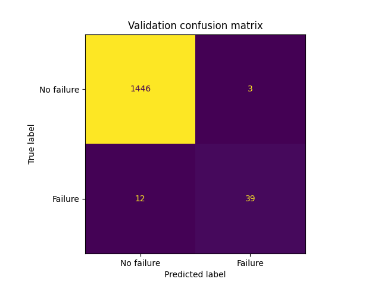
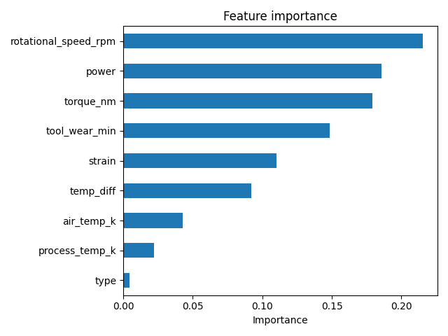

# CNC Shop Predictive Maintenance

Predicting milling machine failures from the machine's current settings, using a reproducible ML pipeline deployed on Google Cloud.

- Live app: https://cnc-failure-predictor.streamlit.app
- Live API: https://cnc-api-943785405592.us-central1.run.app (docs at [/docs](https://cnc-api-943785405592.us-central1.run.app/docs))
- Dataset: [AI4I 2020 Predictive Maintenance, UCI](https://archive.ics.uci.edu/dataset/601)

## What's in this project

| Stage | What I built | Tools |
|---|---|---|
| Data | Cleaned dataset in a public cloud bucket, downloaded by the pipeline on every run | Google Cloud Storage |
| Pipeline | Config driven preprocessing, 3 engineered features, stratified train/validation/test split, random forest | Python, pandas, scikit-learn, `config.yaml` |
| Tracking | Params, metrics, model, plots and config logged for every run | MLflow |
| API | `POST /predict` with input validation and a health check | FastAPI, Uvicorn, Pydantic |
| Container | One image that can either serve the API or train the model | Docker |
| Deployment | Public HTTPS endpoint with cost limits | Artifact Registry, Cloud Run |
| Frontend | Inputs with synced sliders, failure probability, and a breakdown of what's driving the risk | Streamlit Community Cloud |
| Workflow | Feature branches merged through pull requests | Git, GitHub |

```
UCI data → clean → Cloud Storage → train (MLflow) → Docker image → Cloud Run API → Streamlit app
```

## How to Run

### Option 1: Use the live deployment

Open the [live app](https://cnc-failure-predictor.streamlit.app), enter some machine settings and click Predict. Or hit the API directly:

```bash
curl -X POST https://cnc-api-943785405592.us-central1.run.app/predict \
  -H "Content-Type: application/json" \
  -d '{"type": "L", "air_temp_k": 298.2, "process_temp_k": 308.7, "rotational_speed_rpm": 1408, "torque_nm": 46.3, "tool_wear_min": 3}'
```

### Option 2: Run locally

You don't need a Google account. The training data is in a publicly readable bucket and the pipeline pulls it down automatically. Use Python 3.9.

```bash
git clone https://github.com/Praful-Chunchu/cnc-shop-predictive-maintenance-.git
cd cnc-shop-predictive-maintenance-
python3 -m venv .venv
source .venv/bin/activate
pip install -r requirements.txt

python -m src.train                  # download data, train, log to MLflow, save the model
uvicorn api.main:app --port 8000     # API at http://localhost:8000/docs
```

In other terminals (venv active):

```bash
pip install -r app/requirements.txt
streamlit run app/streamlit_app.py   # frontend at http://localhost:8501
mlflow ui --port 5001                # past runs at http://localhost:5001
```

### Option 3: Run with Docker

Train first so `models/model.joblib` exists, then:

```bash
docker build --platform linux/amd64 -t cnc-api .
docker run -p 8000:8080 cnc-api      # API at http://localhost:8000/docs
```

More detail on every step is in [Setup Details](#setup-details) below.

## Overview

Milling machines cut metal parts with a spinning tool. If one fails partway through a run, the part is usually scrapped and the line stops. In aerospace that can mean throwing away an expensive block of aluminum or titanium. Most shops either service machines on a fixed schedule or fix them after they break, and both waste money.

The question this project answers is: **given the machine's settings before a run starts, how likely is it to fail?** If the risk is high, an operator can inspect or adjust the machine first instead of finding out the hard way.

On the validation set the model reaches an F2 score of 0.793. It catches 39 of 51 failures (recall 0.765), and when it flags a failure it's right 93% of the time (precision 0.929). Details are in [Results](#results).

## Dataset

The [AI4I 2020 dataset](https://archive.ics.uci.edu/dataset/601) (Matzka, 2020) has 10,000 rows, one per machine run. It's synthetic: the authors generated it to reflect real predictive maintenance data, since real factory data is rarely published. There are no missing values.

| Column | Meaning | Role |
|---|---|---|
| `type` | Product quality: L (low, 50% of parts), M (medium, 30%), H (high, 20%) | Input |
| `air_temp_k` | Air temperature around the machine (K) | Input |
| `process_temp_k` | Temperature at the cutting point (K) | Input |
| `rotational_speed_rpm` | Spindle speed | Input |
| `torque_nm` | Torque on the tool (Nm) | Input |
| `tool_wear_min` | Minutes the current tool has been in use | Input |
| `machine_failure` | 1 if the run failed | Target |

I dropped a few columns from the raw file:

- `UDI` is just a row number.
- `Product ID` starts with the same letter as `type` in every row, and the rest is a serial number.
- `TWF`, `HDF`, `PWF`, `OSF` and `RNF` record *why* a run failed (tool wear, heat dissipation, power, overstrain, random). They're only known after the failure happens, so using them as inputs would be target leakage.

Only 339 of the 10,000 runs failed (3.39%), so the classes are very imbalanced. A model that always says "no failure" would be 96.6% accurate and completely useless, which drove most of the modeling choices below.


## EDA Highlights

The full analysis is in [`notebooks/01_eda.ipynb`](notebooks/01_eda.ipynb). The main things I found:

- No duplicates once the ID columns are removed.
- The failure type counts add up to 355 even though there are only 339 failures, so some runs failed for two reasons at once. Heat dissipation was the most common (115), followed by overstrain (98), power (95), tool wear (46) and random (1).
- Failed runs had higher torque (median 53.7 vs 39.9 Nm), more tool wear (165 vs 107 min) and mostly lower speed (1,365 vs 1,507 rpm), plus a separate group of failures at very high speed.
- Type L parts failed 3.92% of the time, compared to 2.77% for M and 2.09% for H. L has the lowest overstrain limit.
- The labels have a couple of inconsistencies. 18 rows flag a random failure but have `machine_failure = 0`, and 9 failures have no failure type flagged at all. I kept `machine_failure` as the source of truth and left these rows in.

## Feature Engineering

The dataset documentation spells out the physical rule behind each failure type, and several of them depend on two inputs together. A tree can only split on one column at a time, so I added the combinations as features (`src/features.py`):

| Feature | Formula | Failure type | Documented rule |
|---|---|---|---|
| `temp_diff` | process temp − air temp | Heat dissipation | Fails when the gap is under 8.6 K and speed is under 1,380 rpm |
| `power` | torque × speed in rad/s (W) | Power | Fails below 3,500 W or above 9,000 W |
| `strain` | tool wear × torque | Overstrain | Fails above 11,000 (L), 12,000 (M) or 13,000 (H) |

For example, two runs at 1,200 rpm with 30 Nm and 25 Nm of torque look normal on both inputs, but the second one is at 3,142 W, which is below the 3,500 W limit. Only the `power` feature makes that visible in a single split.

All three features separated failures well in EDA, especially `strain`, whose median nearly doubles for failed runs (3,953 vs 7,682). In the trained model they account for about 39% of total feature importance, and `power` ranks second overall.

Each feature only uses values from its own row, so there's no leakage across the train/test split. The API calls the same `add_engineered_features()` function as training, so the features are always computed the same way.

## Model

`src/train.py` builds a scikit-learn pipeline: a `ColumnTransformer` that ordinal encodes `type` (L=0, M=1, H=2) and passes the numeric columns through, followed by a `RandomForestClassifier`. Keeping the encoder inside the pipeline means it gets saved with the model and the API can't skip it.

I went with a random forest because power failures happen at both ends (too low or too high), which a single linear boundary can't capture well, and because trees don't need feature scaling and give feature importance for free.

| Setting | Value | Reason |
|---|---|---|
| `n_estimators` | 200 | Stable predictions without being slow |
| `max_depth` | 10 | Limits overfitting |
| `class_weight` | balanced | Each failure counts about 28x more than a normal run in training |
| `random_state` | 42 | Same split and same model every run |

The data is split 70/15/15 into train, validation and test, stratified so each set keeps the 3.4% failure rate. Validation is used for decisions like settings and the threshold. The test set is held back for a final evaluation.

For the metric I used **F2**. A missed failure means a broken machine and a scrapped part, while a false alarm just means a few minutes of inspection, so recall matters more than precision. Recall alone isn't enough though, since flagging every run gets 100% recall. F2 balances the two with extra weight on recall.

The model outputs a failure probability, and a run is flagged when it's at or above the threshold in `config.yaml` (currently 0.5).

## Results

Validation set, 1,500 runs with 51 failures:

| Metric | Score |
|---|---|
| F2 | 0.793 |
| Recall | 0.765 |
| Precision | 0.929 |
| F1 | 0.839 |
| Accuracy | 0.990 |



The model misses 12 of the 51 failures and raises only 3 false alarms. That's more cautious than you'd want for maintenance, where an extra inspection is cheap. Lowering the threshold should trade a few more false alarms for fewer misses, and that's the first thing I'd tune next.



Speed, torque and tool wear drive most predictions, which matches the EDA. `type` barely matters directly because its effect mostly shows up through `strain`.

Two example requests to the live API:

| Scenario | Failure probability |
|---|---|
| Fresh tool, normal settings (L, 298.2 K, 308.7 K, 1,408 rpm, 46.3 Nm, 3 min) | 0.04% |
| Small temperature gap at low speed, worn tool, high torque (L, 302.1 K, 310.1 K, 1,301 rpm, 60.9 Nm, 220 min) | 91.9% |

The second one breaks two documented rules at once: an 8.0 K temperature gap below 1,380 rpm, and strain of 13,394, which is over the 11,000 limit for type L.

## Experiment Tracking

Every training run is logged to the MLflow experiment `cnc-failure-prediction`:

- **Params:** `n_estimators`, `max_depth`, `class_weight`, `test_size`, `val_size`
- **Metrics:** `val_f2`, `val_recall`, `val_precision`, `val_f1`, `val_accuracy`
- **Model:** the full pipeline, with an input example so the expected columns are recorded
- **Plots:** confusion matrix and feature importance
- **Config:** a copy of `config.yaml`, so any run can be traced back to its exact settings

To browse runs, use `mlflow ui --port 5001` and open http://localhost:5001. I use 5001 because AirPlay on macOS usually holds port 5000.

## Configuration

All the settings live in `config.yaml`, so trying something different means changing a number, not the code.

```yaml
data:
  raw_path: data/raw/ai4i2020.csv
  cleaned_path: data/cleaned/ai4i2020_cleaned.csv
  gcs_bucket: cnc-pm-data-praful
  gcs_cleaned_blob: cleaned/ai4i2020_cleaned.csv

features:
  target: machine_failure
  categorical: [type]
  numeric: [air_temp_k, process_temp_k, rotational_speed_rpm, torque_nm, tool_wear_min, temp_diff, power, strain]
  type_order: [L, M, H]

split:
  test_size: 0.15
  val_size: 0.15
  random_state: 42
  stratify: true

model:
  type: random_forest
  path: models/model.joblib
  params:
    n_estimators: 200
    max_depth: 10
    class_weight: balanced

evaluation:
  primary_metric: f2
  threshold: 0.5

mlflow:
  experiment_name: cnc-failure-prediction
```

## Project Structure

```
cnc-shop-predictive-maintenance/
├── config.yaml
├── requirements.txt
├── Dockerfile
├── .dockerignore
├── data/
│   ├── raw/                 # original UCI CSV (gitignored)
│   └── cleaned/             # cleaned CSV (gitignored, the bucket is the source of truth)
├── notebooks/
│   └── 01_eda.ipynb
├── src/
│   ├── data.py              # load, clean, download from GCS
│   ├── features.py          # dropped columns and engineered features
│   └── train.py             # split, train, evaluate, log to MLflow, save
├── api/
│   └── main.py              # FastAPI app
├── app/
│   ├── streamlit_app.py
│   └── requirements.txt     # deployed separately, only needs streamlit and requests
├── docs/images/             # charts used in this README
└── models/                  # model.joblib (gitignored)
```

## Setup Details

### Preparing the data

The cleaned data is already in a public bucket, so you can skip this unless you want to recreate it or host it yourself.

1. Download the raw CSV from [UCI](https://archive.ics.uci.edu/dataset/601) and save it as `data/raw/ai4i2020.csv`.
2. Run `python -m src.data`. It drops the ID and leakage columns, renames everything to snake_case and writes `data/cleaned/ai4i2020_cleaned.csv`.
3. Upload it to your own bucket and make it publicly readable:

```bash
gcloud auth login
gcloud config set project <YOUR_PROJECT_ID>
gcloud storage buckets create gs://<YOUR_BUCKET> --location=us-central1
gcloud storage cp data/cleaned/ai4i2020_cleaned.csv gs://<YOUR_BUCKET>/cleaned/ai4i2020_cleaned.csv
gcloud storage buckets add-iam-policy-binding gs://<YOUR_BUCKET> \
  --member=allUsers --role=roles/storage.objectViewer
```

Then update `gcs_bucket` in `config.yaml`.

### Training

`python -m src.train` downloads the cleaned CSV from the bucket (anonymously, no login needed), adds the engineered features, splits the data, trains, prints the validation metrics, logs everything to MLflow and saves the pipeline to `models/model.joblib`. Run it with `python -m` from the repo root so the `src` imports resolve.

Expected output:

```
Downloaded gs://cnc-pm-data-praful/cleaned/ai4i2020_cleaned.csv to data/cleaned/ai4i2020_cleaned.csv
Validation results
F2:        0.793
Recall:    0.765
Precision: 0.929
F1:        0.839
Accuracy:  0.990
Model saved to models/model.joblib
```

### Running the API locally

```bash
uvicorn api.main:app --reload --port 8000
```

Check http://localhost:8000 for the health check and http://localhost:8000/docs to try requests in the browser, or use curl:

```bash
curl -X POST http://localhost:8000/predict \
  -H "Content-Type: application/json" \
  -d '{"type": "L", "air_temp_k": 298.2, "process_temp_k": 308.7, "rotational_speed_rpm": 1408, "torque_nm": 46.3, "tool_wear_min": 3}'
```

This should return `{"failure_probability":0.0004303586428080528,"prediction":0}`.

### Docker

The image contains the API, the trained model and all dependencies, so train before building. The `--platform` flag is there so an image built on an Apple Silicon Mac still runs on Cloud Run.

```bash
docker build --platform linux/amd64 -t cnc-api .
docker run -p 8000:8080 cnc-api
```

The default command serves the API. To train inside the container instead, override the command and mount the data and models folders so the results end up on your machine:

```bash
docker run --rm \
  -v "$(pwd)/data:/app/data" \
  -v "$(pwd)/models:/app/models" \
  cnc-api python -m src.train
```

The Dockerfile copies `requirements.txt` and installs packages before copying the code, so changing code doesn't trigger a full reinstall. The trained model is copied into the image, which means containers start right away and all serve the same model.

### Deploying to Cloud Run

One time setup:

```bash
gcloud services enable storage.googleapis.com artifactregistry.googleapis.com run.googleapis.com
gcloud artifacts repositories create cnc-repo --repository-format=docker --location=us-central1
gcloud auth configure-docker us-central1-docker.pkg.dev
```

Each deployment (bump the tag for new versions):

```bash
docker tag cnc-api us-central1-docker.pkg.dev/<YOUR_PROJECT_ID>/cnc-repo/cnc-api:v1
docker push us-central1-docker.pkg.dev/<YOUR_PROJECT_ID>/cnc-repo/cnc-api:v1
gcloud run deploy cnc-api \
  --image us-central1-docker.pkg.dev/<YOUR_PROJECT_ID>/cnc-repo/cnc-api:v1 \
  --region us-central1 \
  --allow-unauthenticated \
  --max-instances 1 \
  --min-instances 0 \
  --port 8080
```

`--max-instances 1` caps cost, and `--min-instances 0` lets the service scale to zero when nobody is using it (the first request after a while takes a few extra seconds). The deploy prints a service URL, and calling it with the same curl request as above returns the same result as running locally.

### Frontend

```bash
pip install -r app/requirements.txt
streamlit run app/streamlit_app.py
```

The app calls the live Cloud Run API, so the API doesn't need to be running locally. To deploy it, create an app on [share.streamlit.io](https://share.streamlit.io) pointing at this repo, branch `main`, file `app/streamlit_app.py`.

Each input has a number box and a slider that stay in sync, limited to the range seen in the training data. Clicking Predict sends the six values to `/predict` and shows the failure probability. Below that, a panel shows the values behind each failure rule (temperature gap, power, strain, tool wear) and whether they're within limits, so it's clear *why* the risk is high. That panel uses the same formulas as `src/features.py`, but the prediction itself always comes from the model.

## API Reference

`GET /` returns `{"status": "ok"}`.

`POST /predict` takes the six raw inputs and returns the failure probability and a 0/1 prediction. The engineered features are computed server side.

Request:

```json
{
  "type": "L",
  "air_temp_k": 298.2,
  "process_temp_k": 308.7,
  "rotational_speed_rpm": 1408,
  "torque_nm": 46.3,
  "tool_wear_min": 3
}
```

Response:

```json
{"failure_probability": 0.0004303586428080528, "prediction": 0}
```

`type` must be `L`, `M` or `H`, and the rest must be numbers. Missing fields, text in a number field, or any other product type return a 422 with a message pointing at the problem field.

## Cloud Services

| Service | Used for |
|---|---|
| Cloud Storage | Hosting the cleaned dataset (`gs://cnc-pm-data-praful/cleaned/`), publicly readable |
| Artifact Registry | Storing the Docker image |
| Cloud Run | Running the API at a public HTTPS URL |
| Streamlit Community Cloud | Hosting the frontend |

Everything on Google Cloud is in `us-central1`. To keep costs under control there's an $8/month spend cap on Cloud Run, a $10/month budget alert on the project, and the instance limits mentioned above.

## Development Workflow

Each piece was built on its own branch and merged into `main` through a pull request:

| PR | Branch | Contents |
|---|---|---|
| #1 | `feature/eda-and-data-prep` | EDA notebook, cleaning, engineered features |
| #2 | `feature/training-pipeline` | Config file and training pipeline |
| #3 | `feature/experiment-tracking` | MLflow tracking |
| #4 | `feature/fastapi-predict` | FastAPI endpoint |
| #5 | `feature/docker` | Dockerfile |
| #6 | `feature/gcs-data-storage` | Downloading data from Cloud Storage |
| #7 | `feature/streamlit-frontend` | Streamlit app |
| #8 | `feature/plots-and-input-validation` | MLflow plots, API input validation, config driven cleaning |
| #9 | `docs/readme` | README and charts |
| #10 | `docs/readme` | Public bucket download, run instructions |
| #11 | `docs/final-touches` | README cleanup and live app link |

Settings come from `config.yaml` and get logged with each run, random seeds are fixed, package versions are pinned, and the Docker image is built for a fixed Python version and platform, so runs are reproducible.

## Ethics and Limitations

A missed failure here isn't just a cost problem. If the app says "low risk" and the machine breaks anyway, it could damage equipment or hurt someone nearby. This should help people decide when to inspect a machine, not replace inspections or a technician's judgment. There's also a risk that operators start trusting the green message over what they can see themselves, which is part of why the app shows a probability and the reasoning behind it instead of just a yes or no.

The risk isn't spread evenly either. Type L parts fail almost twice as often as type H, so if the model does worse on one type, that group absorbs more of the missed failures. I'd want to check performance per type before using this anywhere real.

Other limitations:

- The data is synthetic. The model would need to be retrained and validated on real machine data before anyone relied on it.
- Some labels are inconsistent (the 18 and 9 rows mentioned in the EDA section).
- Random failures happen regardless of conditions, so no model can predict them.
- The sliders keep inputs within the training range, but the API accepts any number, and predictions far outside that range aren't reliable.
- The scores above are on the validation set. The test set hasn't been used yet.
- The API and the data bucket are public. That's fine for a demo with public data, but a real deployment would need authentication, rate limiting and private storage.

## Future Work

- Tune the decision threshold on validation to improve recall, then report a final test score
- Predict the failure type as a multi class problem so operators know what to check
- Add SHAP values to explain individual predictions
- Compare against logistic regression and XGBoost as separate MLflow runs
- Set up CI/CD to rebuild and redeploy on merges to `main`
- Monitor for data drift once real data comes through the API
