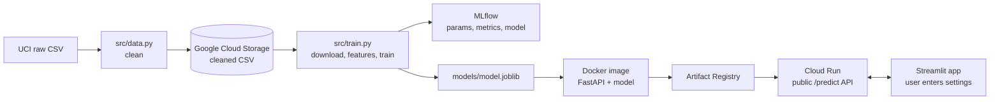
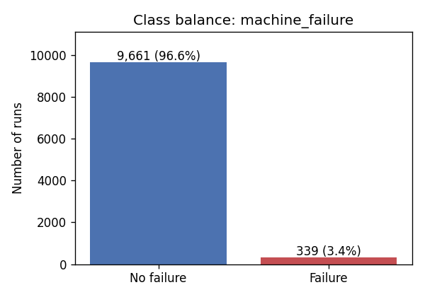

# CNC Shop Predictive Maintenance

**Predicting milling machine failures before they happen, with a reproducible ML pipeline deployed to the cloud.**

| | Link |
|---|---|
| 🖥️ **Live app** (Streamlit) | `TODO: paste your *.streamlit.app link` |
| ⚙️ **Live API** (Cloud Run) | https://cnc-api-943785405592.us-central1.run.app |
| 📄 **Interactive API docs** | https://cnc-api-943785405592.us-central1.run.app/docs |
| 📊 **Dataset** | [AI4I 2020 Predictive Maintenance (UCI)](https://archive.ics.uci.edu/dataset/601) |

---

## Quick Start

### Try it with no setup

1. Open the **live app** (link above), enter machine settings, and click **Predict**.
2. Or call the **live API** directly:

```bash
curl -X POST https://cnc-api-943785405592.us-central1.run.app/predict \
  -H "Content-Type: application/json" \
  -d '{"type": "L", "air_temp_k": 298.2, "process_temp_k": 308.7, "rotational_speed_rpm": 1408, "torque_nm": 46.3, "tool_wear_min": 3}'
```

### Run everything locally

No Google account is needed: the training data lives in a **publicly readable** Cloud Storage bucket, and the pipeline downloads it automatically. Requires Python 3.9.

```bash
git clone https://github.com/Praful-Chunchu/cnc-shop-predictive-maintenance-.git
cd cnc-shop-predictive-maintenance-
python3 -m venv .venv
source .venv/bin/activate
pip install -r requirements.txt

python -m src.train                    # download data from the bucket, train, log to MLflow, save the model
uvicorn api.main:app --port 8000       # serve the API at http://localhost:8000/docs
```

In separate terminals (with the venv active):

```bash
pip install -r app/requirements.txt
streamlit run app/streamlit_app.py     # frontend at http://localhost:8501 (calls the live API)

mlflow ui --port 5001                  # tracked runs at http://localhost:5001
```

### Run with Docker

Train first (above) so the model file exists, then:

```bash
docker build --platform linux/amd64 -t cnc-api .
docker run -p 8000:8080 cnc-api        # API at http://localhost:8000/docs
```

Full explanations of every step are in [Setup and Usage](#11-setup-and-usage).

---

## Table of Contents

1. [Overview](#1-overview)
2. [How It Works](#2-how-it-works)
3. [Dataset](#3-dataset)
4. [Key EDA Findings](#4-key-eda-findings)
5. [Feature Engineering](#5-feature-engineering)
6. [Model](#6-model)
7. [Evaluation](#7-evaluation)
8. [Experiment Tracking (MLflow)](#8-experiment-tracking-mlflow)
9. [Configuration (config.yaml)](#9-configuration-configyaml)
10. [Project Structure](#10-project-structure)
11. [Setup and Usage](#11-setup-and-usage)
12. [API Reference](#12-api-reference)
13. [Cloud Services Used](#13-cloud-services-used)
14. [Development Workflow](#14-development-workflow)
15. [Ethics, Limitations and Future Work](#15-ethics-limitations-and-future-work)

---

## 1. Overview

### The problem

Milling machines carve metal parts using a spinning cutter. When a machine fails in the middle of a run, the part being made is usually scrapped, the line stops, and the machine may need repairs. In industries like aerospace, a single scrapped part can mean an expensive block of aluminum or titanium thrown away.

### Why it matters

Most shops handle this with fixed maintenance schedules or by reacting after something breaks. Both waste money: either parts get replaced too early, or failures happen without warning. Predicting failure **from the machine's current settings, before the run starts,** lets an operator inspect or adjust the machine only when the risk is actually high.

### What this project does

This project builds a complete machine learning system around that question:

> **Given a machine's current conditions, will this run fail?**

It covers the full path from raw data to a live app:

1. Cleans the data and hosts it in **Google Cloud Storage**
2. Trains a model through a **reproducible, config driven pipeline**
3. Tracks every training run with **MLflow**
4. Serves the model as a **FastAPI** endpoint, packaged with **Docker**
5. Deploys the API to **Google Cloud Run**
6. Provides a **Streamlit** app where anyone can enter machine settings and get a prediction

### Results at a glance

| Metric (validation set) | Score |
|---|---|
| **F2 (primary metric)** | **0.793** |
| Recall | 0.765 |
| Precision | 0.929 |
| Accuracy | 0.990 |

The model catches about 3 out of 4 failures, and when it raises an alarm it's right about 93% of the time. See [Evaluation](#7-evaluation) for what these numbers mean and why accuracy alone is misleading here.

---

## 2. How It Works



**In plain words:**

1. **Data:** the raw CSV is cleaned locally, then uploaded to a cloud storage bucket.
2. **Training:** the pipeline downloads the cleaned data from the bucket, adds engineered features, trains a random forest, logs everything to MLflow and saves the trained model.
3. **Serving:** the trained model is packaged with a FastAPI app inside a Docker image.
4. **Deployment:** the image is pushed to Google's container registry and run on Cloud Run, which gives it a public URL.
5. **Frontend:** the Streamlit app sends the user's inputs to that URL and displays the prediction.

---

## 3. Dataset

**Source:** [AI4I 2020 Predictive Maintenance Dataset](https://archive.ics.uci.edu/dataset/601), UCI Machine Learning Repository (Matzka, 2020)

**Important:** this is a **synthetic** dataset. Its creators generated it to reflect real predictive maintenance data from industry, since real factory data is rarely published. It is very clean, with no missing values.

**Size:** 10,000 rows, one row per machine run.

### Columns

| Column (cleaned name) | Meaning | Used as |
|---|---|---|
| `type` | Product quality grade: **L** (low, 50% of parts), **M** (medium, 30%), **H** (high, 20%) | Input |
| `air_temp_k` | Room temperature around the machine, in Kelvin | Input |
| `process_temp_k` | Temperature at the cutting point, in Kelvin | Input |
| `rotational_speed_rpm` | How fast the cutter spins | Input |
| `torque_nm` | How hard the machine twists the cutter, in newton meters | Input |
| `tool_wear_min` | Minutes the current cutting tool has been in use | Input |
| `machine_failure` | 1 if the run failed, 0 if not | **Target** |

### Columns dropped, and why

| Column | Reason |
|---|---|
| `UDI` | Row number. Carries no information about the machine. |
| `Product ID` | Its first letter duplicates `type` (verified in all 10,000 rows). The rest is a serial number. |
| `TWF`, `HDF`, `PWF`, `OSF`, `RNF` | **Target leakage.** These five columns record **why** a run failed (tool wear, heat dissipation, power, overstrain, random). They are only known **after** a failure. Feeding them to the model would produce a near perfect score in testing that is useless in practice, since an operator never has these values beforehand. |

### Target imbalance



Only **339 of 10,000 runs failed (3.39%)**. This shapes every modeling decision below: a model that always predicts "no failure" would score 96.6% accuracy while catching zero failures.

---

## 4. Key EDA Findings

Full analysis: [`notebooks/01_eda.ipynb`](notebooks/01_eda.ipynb)

**Data quality**
1. No missing values and no duplicate rows (checked after removing the unique ID columns)
2. `Product ID` prefix matches `type` in every row

**How failures happen**
1. The five failure types overlap: their counts add up to 355, but there are only 339 failures, so some runs failed for two reasons at once.
2. **Heat dissipation failure is the most common type**, about a third of all failures.

| Failure type | Count |
|---|---|
| Heat dissipation (HDF) | 115 |
| Overstrain (OSF) | 98 |
| Power (PWF) | 95 |
| Tool wear (TWF) | 46 |
| Random (RNF) | 1 |

**Inputs vs failure (medians)**

| Input | No failure | Failure |
|---|---|---|
| Torque (Nm) | 39.9 | **53.7** |
| Tool wear (min) | 107 | **165** |
| Rotational speed (rpm) | 1,507 | **1,365** (plus a separate cluster of failures at very high speed) |
| Air / process temperature | small differences on their own | |

**Failure rate by product type:** L 3.92%, M 2.77%, H 2.09%. Low quality parts fail almost twice as often as high quality parts, because they have the lowest overstrain limit.

**Label inconsistencies** (kept as is, documented as a limitation)

| | `machine_failure` = 0 | `machine_failure` = 1 |
|---|---|---|
| No failure type flagged | 9,643 | **9** (failed, no reason recorded) |
| A failure type flagged | **18** (random failure flagged, no failure) | 330 |

`machine_failure` is treated as the source of truth. The failure type columns are never model inputs, so these 27 rows simply carry their `machine_failure` label.

---

## 5. Feature Engineering

Code: [`src/features.py`](src/features.py) → `add_engineered_features()`

The dataset documentation describes the physical rule behind each failure type. Several rules depend on **combinations** of inputs, which a tree model can only approximate by stacking many single column splits. Three features hand the model those combinations directly.

| Feature | Formula | Targets | Rule from the dataset docs | EDA evidence |
|---|---|---|---|---|
| `temp_diff` | process temp − air temp | Heat dissipation failure | Fails when the gap is under 8.6 K **and** speed is under 1,380 rpm | Lower for failures (median 9.3 vs 9.8 K) |
| `power` | torque × speed in rad/s (watts) | Power failure | Fails when power is under 3,500 W **or** over 9,000 W | Normal runs sit inside the 3,500 to 9,000 W safe range; failures fall outside it on both ends |
| `strain` | tool wear × torque | Overstrain failure | Fails when it passes 11,000 (L), 12,000 (M) or 13,000 (H) | **Strongest separator:** median nearly doubles (3,953 → 7,682) |

**Worked example of why this helps (power):**

| Run | Speed | Torque | Power | Outcome |
|---|---|---|---|---|
| A | 1,200 rpm | 30 Nm | 3,770 W | OK |
| B | 1,200 rpm | 25 Nm | 3,142 W | Fails (under 3,500 W) |

Same speed, and torque values that both look normal on their own. Only power reveals the problem.

**Did they help?** Yes. In the trained model, the three engineered features together account for about **39% of total feature importance**, and `power` is the **second most important feature** overall (see [Evaluation](#7-evaluation)).

**Leakage safety:** each feature uses only values from its own row, so computing it before or after the train/test split gives identical results.

**Training and serving consistency:** the API calls the **same** `add_engineered_features()` function used in training, so the model always sees features computed the same way (no training serving skew).

---

## 6. Model

### Pipeline

Code: [`src/train.py`](src/train.py)

```
Pipeline
├── preprocessor: ColumnTransformer
│     ├── type    → OrdinalEncoder (L=0, M=1, H=2)
│     └── numeric → passthrough
└── model: RandomForestClassifier
```

The encoder lives **inside** the saved pipeline, so the API can never forget to apply it.

### Why a random forest

1. **Handles patterns on both ends.** Power failures happen when power is too low **or** too high. A linear model like logistic regression draws one straight boundary and struggles with this. Trees simply split twice.
2. **No feature scaling needed.** Torque in the 40s and power in the thousands work as is.
3. **Built in feature importance** for explaining predictions.

### Settings (from `config.yaml`)

| Setting | Value | Why |
|---|---|---|
| `n_estimators` | 200 | Enough trees for a stable vote; gains flatten past a few hundred |
| `max_depth` | 10 | Caps how many questions each tree asks in a row, limiting overfitting |
| `class_weight` | balanced | Each failure counts about 28 times more than a normal run during training (weights ≈ 14.75 vs 0.52), so the model can't ignore the rare class |
| `random_state` | 42 | Same data split and same forest every run |

### Data split

**70% train / 15% validation / 15% test**, stratified so each set keeps the 3.4% failure rate (about 51 failures each in validation and test).

1. **Train:** the model learns from it
2. **Validation:** used for decisions such as settings and the decision threshold
3. **Test:** held out and reserved for a single final evaluation

### Metric: F2

| Mistake | Real world cost |
|---|---|
| **Missed failure** (false negative) | Machine breaks mid run: scrapped part, downtime, possible damage |
| **False alarm** (false positive) | A technician inspects a healthy machine for a few minutes |

Missed failures cost far more, so recall matters most. But recall alone can be gamed: predicting "fail" for everything gives 100% recall and about 3% precision. **F2** combines both, weighting recall more heavily.

### Decision threshold

The model outputs a **failure probability**. A run is flagged as a failure when that probability is at least the threshold in `config.yaml` (currently **0.5**).

---

## 7. Evaluation

**Validation set results** (1,500 runs, 51 failures, threshold 0.5)

| Metric | Score | Meaning |
|---|---|---|
| **F2** | **0.793** | Primary metric |
| Recall | 0.765 | Caught 39 of 51 real failures |
| Precision | 0.929 | When it flags a failure, it's right 93% of the time |
| F1 | 0.839 | |
| Accuracy | 0.990 | Inflated by the many easy "no failure" cases |

**Confusion matrix**


| | Predicted OK | Predicted failure |
|---|---|---|
| **Actually OK** | 1,446 | 3 false alarms |
| **Actually failed** | **12 missed** | 39 caught |

**Interpretation:** the model is cautious. It rarely raises a false alarm, but it misses about 1 in 4 failures. For maintenance, the opposite trade is preferable. The clearest next step is lowering the decision threshold on the validation set to trade a few more false alarms for fewer misses (see [Future Work](#future-work)).

**Feature importance**


| Feature | Importance |
|---|---|
| rotational_speed_rpm | 21.5% |
| **power** (engineered) | **18.6%** |
| torque_nm | 17.9% |
| tool_wear_min | 14.8% |
| **strain** (engineered) | **11.0%** |
| **temp_diff** (engineered) | **9.2%** |
| air_temp_k | 4.3% |
| process_temp_k | 2.2% |
| type | 0.5% |

Speed, torque and tool wear drive most predictions, matching the EDA. The engineered features add about 39% combined. `type` contributes little directly, since its effect mostly shows up through the overstrain limits that `strain` captures.

**Example predictions from the live API**

| Scenario | Inputs | Failure probability |
|---|---|---|
| Fresh tool, normal settings | L, 298.2 K, 308.7 K, 1,408 rpm, 46.3 Nm, 3 min | **0.04%** |
| Small temperature gap, low speed, worn tool, high torque | L, 302.1 K, 310.1 K, 1,301 rpm, 60.9 Nm, 220 min | **91.9%** |

The second case trips two documented rules at once: a temperature gap of 8.0 K at under 1,380 rpm (heat dissipation), and strain of 13,394, above the 11,000 limit for type L (overstrain).

---

## 8. Experiment Tracking (MLflow)

Every training run is recorded automatically in the MLflow experiment **`cnc-failure-prediction`**.

| Logged | What | Why |
|---|---|---|
| **Params** | `n_estimators`, `max_depth`, `class_weight`, `test_size`, `val_size` | Know exactly which settings produced a result |
| **Metrics** | `val_f2`, `val_recall`, `val_precision`, `val_f1`, `val_accuracy` | Compare runs side by side |
| **Model** | The full trained pipeline, with an input example and signature | Reload any past model; the example documents the exact input columns |
| **Plots** | `confusion_matrix.png`, `feature_importance.png` | See at a glance how each run performed and what drove it |
| **Config** | `config.yaml` | Every run carries its complete configuration, for reproducibility |

MLflow also stores the model's Python environment (`requirements.txt`, `conda.yaml`, `python_env.yaml`) with each run.

**View the runs:**

```bash
mlflow ui --port 5001
```

Then open http://localhost:5001. (Port 5001 is used because macOS AirPlay often occupies port 5000.)

---

## 9. Configuration (config.yaml)

All settings live in one file, so experiments change numbers, never code. Code holds the **logic**; config holds the **values**. No secrets are stored here.

```yaml
data:
  raw_path: data/raw/ai4i2020.csv
  cleaned_path: data/cleaned/ai4i2020_cleaned.csv
  gcs_bucket: cnc-pm-data-praful
  gcs_cleaned_blob: cleaned/ai4i2020_cleaned.csv

features:
  target: machine_failure
  categorical: [type]
  numeric: [air_temp_k, process_temp_k, rotational_speed_rpm, torque_nm, tool_wear_min, temp_diff, power, strain]
  type_order: [L, M, H]

split:
  test_size: 0.15
  val_size: 0.15
  random_state: 42
  stratify: true

model:
  type: random_forest
  path: models/model.joblib
  params:
    n_estimators: 200
    max_depth: 10
    class_weight: balanced

evaluation:
  primary_metric: f2
  threshold: 0.5

mlflow:
  experiment_name: cnc-failure-prediction
```

| Section | Controls |
|---|---|
| `data` | Local file paths and the cloud bucket location |
| `features` | The target, which columns the model uses, and the order for encoding `type` |
| `split` | Train / validation / test sizes, random seed, stratification |
| `model` | Algorithm settings and where the trained model is saved |
| `evaluation` | Primary metric and the decision threshold |
| `mlflow` | Experiment name |

---

## 10. Project Structure

```
cnc-shop-predictive-maintenance/
├── config.yaml              # all pipeline settings
├── requirements.txt         # pinned packages for the pipeline and API
├── Dockerfile               # image for serving (default) and training
├── .dockerignore            # keeps the venv, data and notebooks out of the image
├── .gitignore
├── README.md
│
├── data/
│   ├── raw/                 # original UCI CSV (gitignored)
│   └── cleaned/             # cleaned CSV (gitignored; source of truth is GCS)
│
├── notebooks/
│   └── 01_eda.ipynb         # exploratory data analysis
│
├── src/                     # the pipeline
│   ├── __init__.py
│   ├── data.py              # load raw data, clean it, download from GCS
│   ├── features.py          # column lists, leakage drops, engineered features
│   └── train.py             # split, train, evaluate, log to MLflow, save model
│
├── api/
│   └── main.py              # FastAPI app: POST /predict, GET /
│
├── app/
│   ├── streamlit_app.py     # frontend
│   └── requirements.txt     # frontend only packages (deployed separately)
│
├── docs/
│   └── images/              # charts used in this README
│
└── models/                  # trained model.joblib (gitignored)
```

**Design choices**
1. **One file per pipeline stage** in `src/`, so each has a single job
2. **API separate from `src/`:** training runs once, serving runs continuously
3. **Frontend separate, with its own requirements:** it deploys to Streamlit Cloud and only needs `streamlit` and `requests`
4. **Data and models are gitignored:** the bucket is the source of truth for data, and models are rebuilt by the pipeline

---

## 11. Setup and Usage

### 11.1 Prerequisites

| Tool | Used for |
|---|---|
| Python 3.9 | Matches the Docker image and pinned package versions |
| Git | Cloning the repo |
| Docker Desktop | Building and running the container |
| Google Cloud CLI (`gcloud`) | Cloud Storage, Artifact Registry, Cloud Run |
| A Google Cloud project with billing enabled | Only needed to host your own data or deploy your own copy |

### 11.2 Clone and install

```bash
git clone https://github.com/Praful-Chunchu/cnc-shop-predictive-maintenance-.git
cd cnc-shop-predictive-maintenance-

python3 -m venv .venv
source .venv/bin/activate          # Windows: .venv\Scripts\activate
pip install -r requirements.txt
```

### 11.3 Prepare the data

**The cleaned data is already hosted in a public bucket,** so you can skip straight to [11.4](#114-train-the-model). The steps below show how it got there, or how to host it in your own bucket.

**1. Download the raw data** from [UCI](https://archive.ics.uci.edu/dataset/601) and save it as `data/raw/ai4i2020.csv`.

**2. Clean it** (drops ID and leakage columns, renames columns; file paths come from `config.yaml`):

```bash
python -m src.data
```

Expected output: `Saved 10000 rows, 7 columns to data/cleaned/ai4i2020_cleaned.csv`

**3. Upload it to Cloud Storage** (one time):

```bash
gcloud auth login
gcloud config set project <YOUR_PROJECT_ID>
gcloud storage buckets create gs://<YOUR_BUCKET> --location=us-central1
gcloud storage cp data/cleaned/ai4i2020_cleaned.csv gs://<YOUR_BUCKET>/cleaned/ai4i2020_cleaned.csv
```

**4. Make it publicly readable** (read only: nobody else can upload, change or delete files):

```bash
gcloud storage buckets add-iam-policy-binding gs://<YOUR_BUCKET> \
  --member=allUsers --role=roles/storage.objectViewer
```

Then set `gcs_bucket` in `config.yaml` to your bucket name.

### 11.4 Train the model

```bash
python -m src.train
```

No Google login is needed. Because the bucket is publicly readable, `download_from_gcs()` in `src/data.py` uses an anonymous client.

**What happens:**
1. Downloads the cleaned CSV from the bucket
2. Adds the engineered features
3. Splits 70/15/15 (stratified)
4. Trains the pipeline
5. Prints validation metrics and the confusion matrix
6. Logs the run to MLflow, including the confusion matrix and feature importance plots
7. Saves the pipeline to `models/model.joblib`

Expected output (abbreviated):

```
Downloaded gs://cnc-pm-data-praful/cleaned/ai4i2020_cleaned.csv to data/cleaned/ai4i2020_cleaned.csv
Validation results
F2:        0.793
Recall:    0.765
Precision: 0.929
F1:        0.839
Accuracy:  0.990
Model saved to models/model.joblib
```

**Run scripts with `python -m` from the repo root** so imports like `from src.features import ...` resolve correctly.

### 11.5 Run and test the API locally

```bash
uvicorn api.main:app --reload --port 8000
```

1. Health check: open http://localhost:8000 → `{"status": "ok"}`
2. Interactive docs: open http://localhost:8000/docs → **POST /predict** → **Try it out**
3. Or with curl, in a second terminal:

```bash
curl -X POST http://localhost:8000/predict \
  -H "Content-Type: application/json" \
  -d '{"type": "L", "air_temp_k": 298.2, "process_temp_k": 308.7, "rotational_speed_rpm": 1408, "torque_nm": 46.3, "tool_wear_min": 3}'
```

Expected: `{"failure_probability":0.0004303586428080528,"prediction":0}`

### 11.6 Run with Docker

The image contains the API, the trained model and all dependencies. **Train first**, so `models/model.joblib` exists before building.

**Build** (the platform flag makes the image run on Cloud Run, even when built on an Apple Silicon Mac):

```bash
docker build --platform linux/amd64 -t cnc-api .
```

**Serve the API** (default entry point):

```bash
docker run -p 8000:8080 cnc-api
```

Then test at http://localhost:8000/docs. `-p 8000:8080` connects port 8000 on your computer to port 8080 inside the container.

**Train inside the container** (training entry point):

```bash
docker run --rm \
  -v "$(pwd)/data:/app/data" \
  -v "$(pwd)/models:/app/models" \
  cnc-api python -m src.train
```

| Part | Why |
|---|---|
| `python -m src.train` | Overrides the default command, so the container trains instead of serving |
| `-v data:/app/data` | Gives the container a folder to save the downloaded CSV into |
| `-v models:/app/models` | Saves the newly trained model back to your computer |
| `--rm` | Removes the container when training finishes |

No credentials are needed, since the bucket is publicly readable.

**How the Dockerfile works**

```dockerfile
FROM python:3.9-slim                  # start from slim Linux with Python 3.9
WORKDIR /app                          # project folder inside the container
COPY requirements.txt .               # copy dependencies first...
RUN pip install --no-cache-dir -r requirements.txt   # ...so this layer is cached
COPY config.yaml .
COPY src/ src/
COPY api/ api/
COPY models/ models/                  # the trained model is baked into the image
CMD ["uvicorn", "api.main:app", "--host", "0.0.0.0", "--port", "8080"]
```

1. **Requirements are copied before the code** so editing code doesn't reinstall every package
2. **The trained model is copied into the image,** so containers start instantly and all serve the same validated model
3. **`0.0.0.0`** accepts requests from outside the container; **port 8080** is Cloud Run's default

### 11.7 Deploy to Google Cloud Run

**Mental model:** the image has to travel from your computer to Google's servers.

```
Your computer → Artifact Registry → Cloud Run → public URL
   (build)        (image storage)     (runs it)
```

**One time setup**

```bash
# turn on the services
gcloud services enable storage.googleapis.com artifactregistry.googleapis.com run.googleapis.com

# create a Docker image repository
gcloud artifacts repositories create cnc-repo \
  --repository-format=docker --location=us-central1

# let Docker push to it using your gcloud login
gcloud auth configure-docker us-central1-docker.pkg.dev
```

**Each deployment**

```bash
# label the image with its full registry address
docker tag cnc-api us-central1-docker.pkg.dev/<YOUR_PROJECT_ID>/cnc-repo/cnc-api:v1

# upload it
docker push us-central1-docker.pkg.dev/<YOUR_PROJECT_ID>/cnc-repo/cnc-api:v1

# run it on Cloud Run
gcloud run deploy cnc-api \
  --image us-central1-docker.pkg.dev/<YOUR_PROJECT_ID>/cnc-repo/cnc-api:v1 \
  --region us-central1 \
  --allow-unauthenticated \
  --max-instances 1 \
  --min-instances 0 \
  --port 8080
```

| Flag | Why |
|---|---|
| `--allow-unauthenticated` | Anyone can call the API, including the Streamlit app |
| `--max-instances 1` | Caps cost: never more than one running container |
| `--min-instances 0` | Scales to zero when idle, so it costs nothing unused. The first request after idle takes a few extra seconds |
| `--port 8080` | Matches the Dockerfile |

The command prints a **Service URL**. Test it:

```bash
curl -X POST https://cnc-api-943785405592.us-central1.run.app/predict \
  -H "Content-Type: application/json" \
  -d '{"type": "L", "air_temp_k": 298.2, "process_temp_k": 308.7, "rotational_speed_rpm": 1408, "torque_nm": 46.3, "tool_wear_min": 3}'
```

Response from the live deployment:

```json
{"failure_probability":0.0004303586428080528,"prediction":0}
```

Identical to the local result, confirming the container behaves the same everywhere.

**To update later:** retrain, rebuild, then repeat the three "each deployment" commands with a new tag such as `:v2`.

### 11.8 Run and deploy the frontend

**Locally:**

```bash
pip install -r app/requirements.txt
streamlit run app/streamlit_app.py
```

Opens at http://localhost:8501. The app calls the **live Cloud Run API**, so it works without running the API locally.

**Deploy to Streamlit Community Cloud:**
1. Go to [share.streamlit.io](https://share.streamlit.io) and sign in with GitHub
2. **Create app** → select this repo, branch `main`, main file `app/streamlit_app.py`
3. Under **Advanced settings**, choose Python 3.9
4. Deploy, and use the generated `*.streamlit.app` link

**How the app works**

1. **Inputs:** the user picks a product type, then sets the 5 numeric inputs by **typing a value or dragging a slider**. Each box and its slider stay in sync, and both are limited to the ranges seen in the training data.
2. **Prediction:** clicking **Predict** sends the 6 values as JSON to the live `/predict` endpoint. The app shows the failure probability, a progress bar, and a clear high risk or low risk message. If any input changes afterward, the app keeps the last result on screen and notes that it needs updating.
3. **"What's driving this prediction":** a panel shows the values behind each documented failure rule (temperature gap, power, strain, tool wear), each marked OK or at risk against its limit. An operator who sees a high risk also sees **why**, for example "strain 13,394, above the 11,000 limit for type L," and knows what to fix.
4. **Transparency:** an expandable section shows the exact request sent to the API.

The panel uses the same formulas as `src/features.py`. It explains the inputs in terms of the documented failure rules; the prediction itself always comes from the model.

---

## 12. API Reference

**Base URL:** https://cnc-api-943785405592.us-central1.run.app

### `GET /`

Health check.

```json
{"status": "ok"}
```

### `POST /predict`

Predicts the failure risk for one machine run. The client sends only the **6 raw inputs**; the API computes `temp_diff`, `power` and `strain` itself, using the same function as training.

**Request body**

| Field | Type | Example |
|---|---|---|
| `type` | string (`L`, `M` or `H`) | `"L"` |
| `air_temp_k` | number | `298.2` |
| `process_temp_k` | number | `308.7` |
| `rotational_speed_rpm` | number | `1408` |
| `torque_nm` | number | `46.3` |
| `tool_wear_min` | number | `3` |

**Response**

| Field | Type | Meaning |
|---|---|---|
| `failure_probability` | number (0 to 1) | The model's estimated chance of failure |
| `prediction` | 0 or 1 | 1 if the probability is at or above the threshold in `config.yaml` |

**Validation:** inputs are checked by a Pydantic model before they reach the model. Each of these returns **HTTP 422** with a message naming the problem field:

1. A missing field
2. Text where a number is expected (for example `"torque_nm": "high"`)
3. A product type other than `L`, `M` or `H` (for example `"type": "X"` returns *"Input should be 'L', 'M' or 'H'"*)

---

## 13. Cloud Services Used

| Service | Role in this project |
|---|---|
| **Google Cloud Storage** | Hosts the cleaned dataset (`gs://cnc-pm-data-praful/cleaned/`), publicly readable. The training pipeline downloads it at the start of every run, with no login required. |
| **Artifact Registry** | Stores the Docker image (`cnc-repo/cnc-api`) so Cloud Run can pull it |
| **Google Cloud Run** | Runs the API container and provides the public HTTPS URL. Scales to zero when idle. |
| **Streamlit Community Cloud** | Hosts the frontend for free |

**Region:** `us-central1` for all Google Cloud resources.

**Cost controls**
1. A **spend cap** of $8/month on Cloud Run, which pauses the service if reached
2. A **budget alert** at $10/month across the project, with emails at 50%, 90% and 100%
3. `--max-instances 1` and `--min-instances 0` on Cloud Run

---

## 14. Development Workflow

Work was done on feature branches named `type/short-description`, each merged into `main` through a pull request.

| PR | Branch | Adds |
|---|---|---|
| #1 | `feature/eda-and-data-prep` | EDA notebook, cleaning step, engineered features |
| #2 | `feature/training-pipeline` | `config.yaml`, training pipeline, model saving |
| #3 | `feature/experiment-tracking` | MLflow tracking |
| #4 | `feature/fastapi-predict` | FastAPI `/predict` endpoint and health check |
| #5 | `feature/docker` | Dockerfile and .dockerignore |
| #6 | `feature/gcs-data-storage` | Cloud Storage download in the pipeline |
| #7 | `feature/streamlit-frontend` | Streamlit app with live predictions and an explanation panel |
| #8 | `feature/plots-and-input-validation` | MLflow plots, product type validation in the API, config driven cleaning paths |
| #9 | `docs/readme` | This README and its charts |

**Reproducibility practices**
1. All settings in `config.yaml`, logged with every MLflow run
2. Fixed random seed for the split and the model
3. Pinned package versions in `requirements.txt`
4. Docker image built for a fixed Python version and platform

---

## 15. Ethics, Limitations and Future Work

### Ethical considerations

1. **Missed failures are a safety issue, not just a cost issue.** A false "low risk" could lead someone to run a machine that then breaks, possibly damaging equipment or injuring someone nearby. This tool should **support** maintenance decisions, never replace inspections, safety checks or a technician's judgment.
2. **Automation bias.** Operators may start trusting the green "low risk" message over their own observations. The app shows a probability, not just a yes or no, and explains which physical limits are close, so the operator stays engaged with the reasoning instead of blindly following a label.
3. **Uneven risk across product types.** Type L parts fail almost twice as often as type H. If the model performs worse for one type, that group carries more of the missed failure risk. Performance should be checked per type before any real use.
4. **Responsibility.** If a prediction is wrong and something breaks, the decision still belongs to the people operating the machine. Any real deployment would need clear policies on how predictions are used.

### Limitations

1. **Synthetic data.** The model learned rules from a simulated dataset. It **must be retrained and validated on real machine data** before being trusted on a real production line.
2. **Label inconsistencies.** 18 rows flag a random failure with no recorded failure, and 9 failures have no recorded cause (see [EDA](#4-key-eda-findings)).
3. **Random failures can't be predicted.** By design, about 0.1% of runs fail regardless of conditions.
4. **Inputs outside the training ranges** may give unreliable predictions. The app's sliders are limited to the ranges seen in the data, but the API accepts any number for the 5 numeric inputs.
5. **Validation scores only.** The test set is held out and has not yet been used for a final score.
6. **Public, unauthenticated API and public data bucket.** Fine for a demo with public data; a real deployment would need authentication, rate limiting, and a private bucket for any proprietary data.

### Future work

1. **Tune the decision threshold** on the validation set to raise recall, then report a single final **test set** score
2. **Predict the failure type** (heat, power, overstrain, tool wear) as a multi class problem, so operators know what to inspect
3. **Explain each individual prediction** with SHAP values, showing exactly how much each input pushed that specific prediction up or down
4. **Compare models** (logistic regression, XGBoost) as separate MLflow runs
5. **Automate deployment** with CI/CD so merging to `main` rebuilds and redeploys
6. **Monitor for data drift** once real machine data flows through the API
